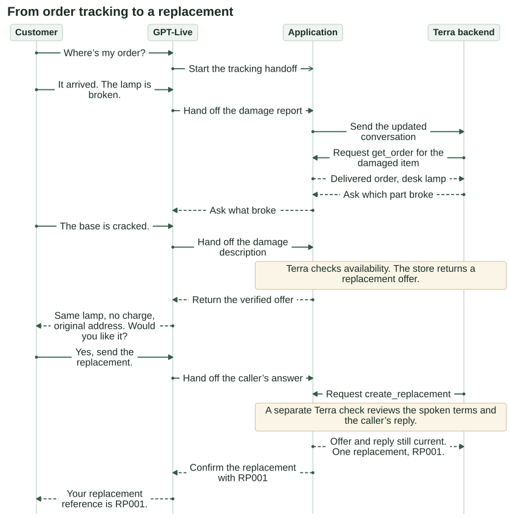
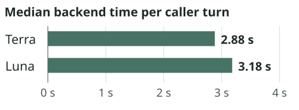
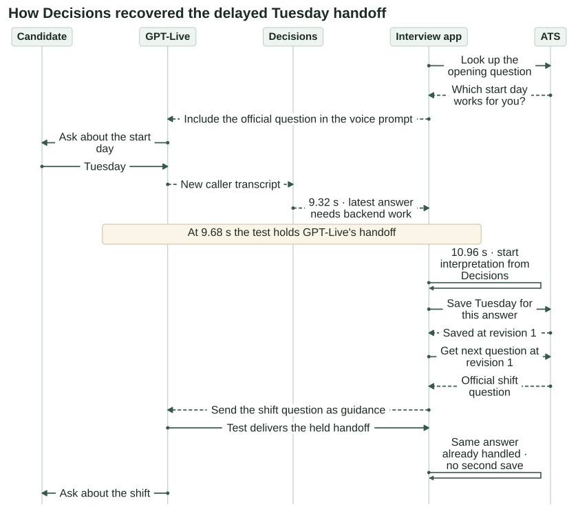

# Build a voice agent that follows an SOP

## Introduction

GPT-Live makes it possible to build voice agents that respond with low latency, handle interruptions, and carry on natural conversations. But many applications also need to follow a detailed procedure, SOP, or structured workflow.

In a chained voice architecture, your application coordinates transcription, a model response, and speech playback, giving you control over when each utterance begins and what it contains. GPT-Live supports a continuous conversation in which listening, speaking, and backend work can overlap. A caller can correct an answer while a lookup is running or interrupt an explanation before hearing a required qualification. That flexibility makes the conversation more natural, but following the procedure requires more than putting the SOP in a prompt.

## What’s included

- **Recordings:** Nine short calls with a synthetic caller and GPT-Live. Each example says what to listen for, such as a replacement offer, a late handoff, or a cancellation.
- **Diagrams and tool timelines:** The diagrams show how the app, voice model, and backend divide the work. The timelines put handoffs, tool arguments, and results next to the recording so you can jump to the moment they happened.
- **Runnable examples:** The [companion package](../examples/audio/sop_voice_workflows/README.md) contains the two apps, their prompts and tools, and instructions for replaying a case offline or trying a call with your microphone.

## Manage workflows during a live call

We’ll use two example workflows: an e-commerce customer service that must follow a return SOP and a scheduling assistant that needs to go question-by-question to determine user availability.

First, we’ll follow a Blossom Store customer who calls about order tracking and tries to negotiate a store credit against policy. Then we’ll walk through an availability interviewer that saves a candidate’s answers and gets subsequent questions from the applicant tracking system (ATS). We’ll listen to the calls alongside the tool logs and track what happens in the voice frontend, backend and application state.

In a [GPT-Live session](https://developers.openai.com/api/docs/guides/live-conversations), the voice model (`gpt-live-1`) speaks with the caller while your app runs the workflow. Give the model the instructions it needs for the conversation and tell it when to hand work to the backend.

1. **[Blossom Store](#example-1-blossom-store).** When a tracking request becomes a damage report, GPT-Live uses [client delegation](https://developers.openai.com/api/docs/guides/live-delegation?delegation-mode=client#configure-client-delegation) to hand the new request to the app. A Responses backend with `gpt-6.1-terra` reads the store SOP and proposes a tool. The app checks the order and the caller’s agreement before creating a replacement.
2. **[Availability interview](#example-2-structured-interviewing).** GPT-Live asks for a start day and preferred shift and delegates after each response. The app saves each clear choice, gets the next official question from the ATS, and asks the candidate to confirm both choices at the end. A [Decisions trigger on the caller’s transcript](https://developers.openai.com/api/docs/guides/decisions-voice#react-to-transcripts) can flag a finished answer if GPT-Live’s handoff is late. The app records which signal actually started the work.

## Prerequisites and setup

Play the recordings inline on the Cookbook site, or use the WebM download links when reading on GitHub. To run the examples, use Python 3.12 and the [companion package](https://github.com/openai/openai-cookbook/blob/b71327cc3713b87229eab2407c07ff8b95c9a00d/examples/audio/sop_voice_workflows/README.md). Run the following commands from the root of your OpenAI Cookbook clone. Use a fresh output directory for each run.

```sh
cd examples/audio/sop_voice_workflows
python3.12 -m venv .venv
source .venv/bin/activate
export PYTHONPATH=.
```

**Replay Blossom offline.** This runs the four scripted caller lines and a scripted backend against the test store. It needs no key, microphone, or package install. Look for `"pass": true` in the terminal and replacement receipt `RP001` in `runs/blossom-reference/reference.json`.

```sh
python -m delivery.runner --reference --out runs/blossom-reference
```

**Talk to Blossom Store.** Connect headphones, set `OPENAI_API_KEY` for a project with access to GPT-Live and Terra, and run these commands. When you see “Connected. Speak now,” try “My desk lamp arrived with a cracked base. Can I get a replacement?” Use Ctrl-C to finish. In `runs/blossom-mic/final-state.json`, check `store.effects` to see whether the store created a replacement. Asking about one leaves the order unchanged until you accept the offer.

```sh
python -m pip install -r requirements.txt
python -m delivery_voice --mic --output runs/blossom-mic
```

**Try the availability interview.** With the same dependencies and access to the interview models, start a fresh call. GPT-Live asks the opening question from the applicant tracking system (ATS).

```sh
python -m interview_app --mic --output runs/interview-01
```

To inspect either configuration offline, run `python -m delivery_voice --describe` or `python -m interview_app --describe`. To test Blossom’s backend without a voice session, [run a text-only case](#choosing-a-backend-for-blossom).

## Example 1: Blossom Store

A customer calls to ask “Where’s my order?” Before the tracking request reaches the store, their roommate brings in the package. “The lamp is broken.”

## 1. Turn the order-support SOP into instructions and tools

Start with the three requests in [Blossom Store’s order-support SOP](https://github.com/openai/openai-cookbook/blob/b71327cc3713b87229eab2407c07ff8b95c9a00d/examples/audio/sop_voice_workflows/delivery/SOP.md). For each one, decide what the backend must look up, what GPT-Live should explain, and what requires the customer’s permission.

- **Track a delivery.** `get_order({})` returns the carrier update for the order the customer selected. GPT-Live can give an estimated delivery date if the carrier returned one.
- **Request a late-delivery credit.** `check_credit_eligibility({})` returns a quote if the order is more than 24 hours late. The credit is the smaller of $20 and the order total. GPT-Live gives the amount, explains that it goes to the original payment method, and asks permission. After a clear yes, the backend requests `register_credit` with the quote ID.
- **Replace a damaged item.** Once the customer describes the damage, `check_replacement_availability` checks the item on their order. The carrier must show it was delivered, and the same item must be in stock. GPT-Live offers the same item at no charge, sent to the original order address. After a clear yes, the backend requests `create_replacement` with the offer ID.

Let's look at this detail from the store SOP and follow it into the implementation.

> If the customer corrects a detail or changes their request, use the latest information.

| Where the rule belongs | How this example implements it |
| --- | --- |
| GPT-Live’s prompt | “Hand off order questions, damage descriptions, requests for a credit, and replies to an open offer to the backend.” When the caller reports damage, GPT-Live delegates and hands off the new request. |
| Terra’s prompt | “A previously interrupted lookup supplies no usable result.” Terra reads the selected order again. Once it has the item ID and knows what broke, it requests `check_replacement_availability`. |
| Application code | Match each handoff to the caller’s words by its timestamp. If a tracking handoff arrives after the caller reports damage, discard it. Before creating a replacement, check that the caller agreed to the offer the store just made. |

## 2. Call flow

1. **“Where’s my order?”** GPT-Live delegates the tracking request. In this test, we delay the tracking handoff until the caller starts reporting the broken lamp. We check that the app skips the outdated tracking lookup and follows the replacement procedure when GPT-Live hands off the damage report.
2. **“Actually, my roommate just brought it in. The lamp is broken.”** The new request takes priority. The backend retrieves the order for the damage report and asks which part of the lamp is broken.
3. **“The base is cracked.”** The backend uses the item ID from the order and the customer’s description to check stock. The store offers another desk lamp at no charge, shipped to the original order address. GPT-Live can now explain those terms and ask whether the customer wants the replacement.
4. **“Yes, send the replacement.”** Terra requests `create_replacement({"offer_id": "REPL-LAMP-1"})`. Before issuing a new replacement, the current app runs a separate consent check with Terra to confirm whether the customer agreed to the offer GPT-Live described. The store checks that the offer is still current and records one replacement. GPT-Live can read back the store’s receipt.



Trace the late tracking handoff and the replacement in the [full-size Blossom Store diagram](../examples/audio/sop_voice_workflows/diagrams/store-order-support.svg).

<a id="lets-listen-and-inspect-the-tool-calls"></a>

## Listen to the broken-lamp call

In this call, the customer starts with “Where’s my order?” and ends with a confirmed replacement for a broken desk lamp.

<audio controls preload="metadata" aria-label="Blossom Store. A customer reports a broken lamp and accepts a replacement." src="../examples/audio/sop_voice_workflows/recordings/blossom-late-handoff.webm">
  <a href="../examples/audio/sop_voice_workflows/recordings/blossom-late-handoff.webm?raw=true">Download the broken-lamp call (WebM)</a>
</audio>

<details id="blossom-tool-calls" style="border: 1px solid #84848455; border-radius: 8px; padding: 0.75rem 1rem">
<summary style="cursor: pointer"><strong>Show tool calls</strong></summary>

Times are measured from the start of the recording. Expand a call to see its arguments and what happened.

<details>
<summary style="cursor: pointer">0:03.18 · Hold the original tracking handoff</summary>

The test deliberately held GPT-Live’s tracking handoff. It released that same event at **0:03.78**, when the caller began reporting the damage. Its timestamp still referred to the tracking request. The app ignored it before it could run a store tool.

</details>
<details>
<summary style="cursor: pointer">0:07.52 · GPT-Live hands the damage report to the app</summary>

GPT-Live sent a second delegation for “The lamp is broken.” The app passed the updated conversation to Terra, which requested the order for the damage report.

</details>
<details>
<summary style="cursor: pointer">0:09.42 · Read the order for the damaged item</summary>

`get_order({})`

The store returned `shipping_status: delivered` and identified the item as a desk lamp (`LAMP-1`). GPT-Live asked which part was damaged.

</details>
<details>
<summary style="cursor: pointer">0:22.52 · Check whether the lamp can be replaced</summary>

`check_replacement_availability({"item_id": "LAMP-1", "damage_description": "The base is cracked"})`

The store offered the same lamp at no charge, shipped to the original order address. It returned offer ID `REPL-LAMP-1`. GPT-Live explained the terms and asked permission.

</details>
<details>
<summary style="cursor: pointer">0:39.14 · Create the replacement after the customer accepts</summary>

`create_replacement({"offer_id": "REPL-LAMP-1"})`

The caller started saying “Yes, send the replacement” at **0:34.84**. The store returned `status: created` and `RP001`. GPT-Live then read back the reference.

</details>

Use the [full call timeline](../examples/audio/sop_voice_workflows/recordings/broken-lamp.html) to jump from a tool call to that moment in the recording.

</details>

## Policy negotiation

We want to make sure we're following policy for something consequential like a credit. If GPT-Live asks, “May I put a $20 credit back on your original payment method?” **“That works for me. Let’s do that”** is a clear confirmation, but **“Yes, but can you make it $35?”** still requires conversation before we confirm any credit.

Terra follows the SOP and chooses which tool to request. When it proposes issuing a new credit or creating a replacement, the app makes a second, tool-free Responses call to Terra. It supplies the verified terms, GPT-Live’s offer and the caller’s whole reply. Terra identifies the words that conveyed each required term and decides whether the caller agreed. For example, if GPT-Live offers another lamp but never mentions the price, the cost field should be empty. The app requires evidence for every term and an `accepted` decision before it proceeds.

Python checks facts the store can verify. The offered quote must still belong to this order, the caller’s reply must still be current, and the store must have no prior submission for that offer. An uncertain or unavailable review leaves the ledger untouched. If the caller speaks again while that check is running, the app discards the old decision.

**The caller asks for $35.** GPT-Live explains that the store can offer $20 and asks whether the caller wants it. The store issues no credit.

<audio controls preload="metadata" aria-label="Blossom Store. The caller asks for $35 after a $20 offer." src="../examples/audio/sop_voice_workflows/recordings/blossom-consent-counteroffer.webm">
  <a href="../examples/audio/sop_voice_workflows/recordings/blossom-consent-counteroffer.webm?raw=true">Download the $35 counteroffer (WebM)</a>
</audio>

<details><summary><strong>Inspect the counteroffer tool calls</strong></summary>

At 0:06.10 the store retrieved the order with `get_order`. At 0:07.26 `check_credit_eligibility` returned a $20 quote. After the caller asked for $35, GPT-Live handed the reply to Terra at 0:22.90. Terra asked for no write, so the app had no consent check to run. The ledger stayed empty.

We also [tested a mistaken write request](../examples/audio/sop_voice_workflows/delivery/consent-results.json) with the same reply. When the test proposed registering the $20 quote anyway, the consent check returned `not_accepted` and the store rejected it.

</details>

**The caller accepts.** This caller says, “That works for me. Let’s do that.” Listen for the offer before the reply and the confirmation after the store issues the credit.

<audio controls preload="metadata" aria-label="Blossom Store. The caller accepts the $20 credit in their own words." src="../examples/audio/sop_voice_workflows/recordings/blossom-consent-acceptance.webm">
  <a href="../examples/audio/sop_voice_workflows/recordings/blossom-consent-acceptance.webm?raw=true">Download the accepted $20 credit (WebM)</a>
</audio>

<details><summary><strong>Inspect the accepted credit and its consent check</strong></summary>

The store retrieved the order at 0:05.84 and checked eligibility at 0:06.88. After the caller accepted, Terra proposed `register_credit({"quote_id":"CREDIT-20"})`. The consent review found the $20 amount, original payment method and request for permission in GPT-Live’s offer. At 0:25.14 the store registered the quote and returned `RF001`. The ledger contains one credit. The [recorded tool timelines](../examples/audio/sop_voice_workflows/recordings/blossom-consent-calls.json) include the reviewer’s evidence alongside both final ledgers.

```json
{
  "decision": "accepted",
  "spoken_evidence": {
    "amount": "twenty dollar credit",
    "payment_method": "your original payment method",
    "permission_request": "Would you like me to register it?"
  }
}
```

</details>

<details><summary><strong>Hear what happens when the caller interrupts the offer</strong></summary>

Listen for GPT-Live to repeat the credit terms and ask permission again before the store issues the credit.

<audio controls preload="none" aria-label="Blossom Store. The caller interrupts the credit offer and asks GPT-Live to repeat it." src="../examples/audio/sop_voice_workflows/recordings/blossom-interruption.webm">
  <a href="../examples/audio/sop_voice_workflows/recordings/blossom-interruption.webm?raw=true">Download the interrupted offer (WebM)</a>
</audio>

In this earlier recording, the caller spoke over GPT-Live at 0:10.82 before it had asked permission. GPT-Live repeated the $20 amount, named the original payment method, and asked again. The caller’s new “Yes” began at 0:20.92. The store registered the credit once at 0:23.74.

</details>

<a id="choosing-backend-models"></a>

## Choosing a backend for Blossom

With client delegation, our app chooses which model handles store requests from GPT-Live. We chose `gpt-6.1-terra` because it followed Blossom’s SOP more consistently than Luna in our tests.

**Following the SOP.** In the [original backend test](https://github.com/openai/openai-cookbook/blob/b71327cc3713b87229eab2407c07ff8b95c9a00d/examples/audio/sop_voice_workflows/delivery/REPORT.md#how-we-compared-the-backends), both models received the same SOP, five store tools, and scripted text replies. We ran this test before adding a separate consent check.

| Recorded backend runs, rescored | Terra | Luna |
| --- | ---: | ---: |
| Runs that followed the full SOP | 68/68 | 65/68 |
| Asked permission again after a clear yes | 0/29 | 0/29 |
| Total store tool calls | 157 | 172 |

One caller replied to a $20 offer with “Yes, but can you make it $35?” Terra asked whether $20 was acceptable. In [one Luna run](../examples/audio/sop_voice_workflows/delivery/results.json), Luna requested the credit. The test store checked that the caller had replied to a current, unused quote. It relied on Luna to interpret the reply, so it issued $20.

We [graded the saved replies again](../examples/audio/sop_voice_workflows/delivery/credit-grade-results.json) using a text reviewer that reads the full credit offer without seeing the expected price. It identifies the amount actually offered, where the money would go and whether the agent asked permission. Code compares its findings with the store’s quote. One additional Luna reply offered the correct $20 but omitted the quote ID the app needed to record a new offer. No credit was issued in that run. This check grades the backend’s text. To find out what GPT-Live actually said, use the receiver audio.

The [timings](../examples/audio/sop_voice_workflows/diagrams/blossom-backend-time.json) cover the backend’s work for each scripted reply, including tool calls. Twelve of Luna’s 15 extra calls were order lookups.



**Checking consent.** Today, before the store issues a new credit or replacement, a separate Terra call checks whether GPT-Live explained the store’s terms and the caller agreed to them.

We [tested this check](https://github.com/openai/openai-cookbook/blob/b71327cc3713b87229eab2407c07ff8b95c9a00d/examples/audio/sop_voice_workflows/delivery/REPORT.md#checking-consent-before-a-write) by asking the store to go ahead in every trial, even when the caller said no. A trial passed when the review finished and the store correctly issued or withheld the credit or replacement. Across 78 cases with repeats, Terra passed **142/142** trials and Luna passed **133/142**. The Terra check took a median of 2.00 seconds.

**Try the broken-lamp case.** With the dependencies installed and `OPENAI_API_KEY` set for a project with Terra access, run this text-only test of the current app.

```sh
python -m delivery.runner --ids status_to_damage --out runs/blossom-terra
```

Open `status_to_damage__gpt-6.1-terra__1.json` in the output directory to see the tool calls, their results, and the grade. A passing run records one replacement. You can also [run the case with both backends](https://github.com/openai/openai-cookbook/blob/b71327cc3713b87229eab2407c07ff8b95c9a00d/examples/audio/sop_voice_workflows/delivery/REPORT.md#try-the-same-case).

## Example 2: Structured interviewing

We're building a simple scheduler - the interviewer needs to collect two preferences, a start day and a shift. The ATS supplies the opening question before the call. After each clear choice the app saves the answer and looks up what to ask next. The app has to be able to handle the candidate changing their answer or their choice at any time.

## 1. Start the session with the first question

Seed GPT-Live with the opening question from the ATS, “Which start day works for you, Monday or Tuesday?” The [interview prompts](https://github.com/openai/openai-cookbook/blob/b71327cc3713b87229eab2407c07ff8b95c9a00d/examples/audio/sop_voice_workflows/interview_app/meaning.py) give each model a different job.

| Who | What we ask it to do |
| --- | --- |
| **GPT-Live**, the interviewer | Ask one official question at a time. Hand answers, corrections, and requests to the app. Wait for the app to supply the next question. |
| **Decisions**, watching the transcript | As the candidate speaks, ask “Does the app have work to do?” (`needs_backend_v1`) and “Does the answer depend on something?” (`condition_v1`). Decisions can revise either label as more words arrive. |
| **Luna**, the backend interpreter | Read the interviewee's reply alongside the current question, interview record, and Decisions labels. Propose a next step, such as saving a day, clarifying a condition, or repeating the question. |

The app checks Luna’s proposal against the current ATS record before it saves an answer. A Decisions result can start that check when a handoff is missing. If the check is already running, the trigger adds no second save.

## When one reply answers two questions

GPT-Live asks which day the candidate can start. “Yeah, I could work any shift on Monday” answers two questions at once. At **0:10.10**, GPT-Live hands the reply to the app. Decisions also flags the answer. The app starts the backend work once, from GPT-Live’s handoff.

At **0:13.26**, the app saves Monday and asks the ATS what comes next. The ATS returns the shift question and lists `either` as an allowed answer. Since the candidate already said any shift works, the app saves `either` and asks the ATS again. Only the confirmation goes back to GPT-Live. Listen for the interviewer to read back both choices and ask the candidate to confirm them.

<audio controls preload="metadata" aria-label="Availability interview. The candidate can work any shift on Monday." src="../examples/audio/sop_voice_workflows/recordings/interview-multi-answer.webm">
  <a href="../examples/audio/sop_voice_workflows/recordings/interview-multi-answer.webm?raw=true">Download the Monday interview (WebM)</a>
</audio>

<details>
<summary>Inspect the Monday tool calls</summary>

The timeline groups four calls at **0:13.26**, in the order the app ran them.

| ATS call | Result |
| --- | --- |
| `record_answer({"question_id": "day", "value": "Monday"})` | Saved Monday at revision 1. |
| `get_next_question({})` | Returned the shift question with `either` among the allowed answers. |
| `record_answer({"question_id": "shift", "value": "either"})` | Saved the shift at revision 2. |
| `get_next_question({})` | Returned the confirmation question. |

At **0:29.00**, after the candidate confirmed both choices, `complete_interview({"day": "Monday", "shift": "either"})` recorded completion at revision 3.

</details>

Open the [full Monday timeline](../examples/audio/sop_voice_workflows/recordings/interview-multi-answer.html) to jump to a handoff or tool call in the recording.

**When an answer has a condition.** The candidate says, “Tuesday, if the shift ends before five.” GPT-Live hands the answer to the app. The app keeps Tuesday and the candidate’s condition together. The ATS has no shift hours to check, so GPT-Live explains that and asks whether to leave Tuesday unconfirmed. Listen for the follow-up. The ATS still had no confirmed start day when the call ended.

<audio controls preload="metadata" aria-label="Interview call with tentative Tuesday availability and a five o'clock finish condition" src="../examples/audio/sop_voice_workflows/recordings/interview-conditional-clarification.webm">
  <a href="../examples/audio/sop_voice_workflows/recordings/interview-conditional-clarification.webm?raw=true">Download the conditional Tuesday answer (WebM)</a>
</audio>

<details>
<summary>What happened in the two test calls?</summary>

In both calls, GPT-Live made the handoff itself. It briefly acknowledged the candidate while the app worked, then asked about leaving Tuesday open. In the featured call, the first voiced part of that follow-up reached the receiver 0.98 seconds after the app returned guidance. In the second, the receiver audio was also clear, but two caption words shared a timing frame with the guidance. The [recording checks and ATS results](../examples/audio/sop_voice_workflows/recordings/interview-conditional-clarification.json) include the earlier attempts and five text tests of what happens next. Repeating “Tuesday” leaves the condition open. Explaining that the condition has been resolved can confirm the day.

</details>

Once the ATS has a day and shift, it returns both as a summary. GPT-Live reads them back, explains that this records availability and does not confirm a job offer, and asks the candidate to confirm both. Before completing the interview, the app [checks the current summary and its delivery evidence](https://github.com/openai/openai-cookbook/blob/b71327cc3713b87229eab2407c07ff8b95c9a00d/examples/audio/sop_voice_workflows/interview_app/workflow.py#L188-L199). If the app can verify only part of the spoken summary, it keeps the saved answers and asks GPT-Live to read them back again. A correction calls for a fresh summary with the updated answers.



## 2. Missed or late delegation

In the [recorded Tuesday call](../examples/audio/sop_voice_workflows/recordings/interview-handoff.html), Decisions flagged the answer at **0:09.32**. GPT-Live delegated at **0:09.68**, but the test deliberately held that handoff. At **0:10.96**, the controller logged `decisions_recovery` and asked Luna to interpret the answer. At **0:12.66**, the ATS saved Tuesday once and returned the shift question. The late handoff reached the same answer and produced no second save.

<audio controls preload="metadata" aria-label="Tuesday answer with a deliberately delayed handoff" src="../examples/audio/sop_voice_workflows/recordings/interview-handoff.webm">
  <a href="../examples/audio/sop_voice_workflows/recordings/interview-handoff.webm?raw=true">Download the late Tuesday handoff (WebM)</a>
</audio>

Read the `reason` on the controller’s `app.route` event to see what started interpretation. The app records one reason for each transcript update it processes.

| Route in the log | What happened |
| --- | --- |
| `native_delegation` | GPT-Live handed the answer to the app. Decisions may also have flagged it. |
| `decisions_recovery` | No handoff had claimed this answer. Decisions flagged the latest transcript update as needing backend work. |
| `settled_unclassified` | Neither a handoff nor a positive Decisions result was available. After 1.8 seconds without new speech or transcript text, this example asks Luna to interpret what it has. A trigger that labels the reply as a backchannel skips this fallback. |

Starting interpretation does not authorize a save. For example, when no condition label is available, a timeout alone cannot commit Tuesday. The [controller](https://github.com/openai/openai-cookbook/blob/b71327cc3713b87229eab2407c07ff8b95c9a00d/examples/audio/sop_voice_workflows/interview_app/live.py) marks the transcript update as in progress before it starts the interpreter. All three routes use that check.

```python
# Excerpt from Controller.tick, with timing and logging omitted.
if t.source in t.jobs or t.done == t.source:
    return
t.jobs.add(t.source)
scope = {"turn": t.number, "source_event_id": t.source,
         "revision": self.store.snapshot()["revision"]}
self.start(self.process(t, scope, labels))
```

**Is Tuesday still the answer?** While Luna is interpreting “Tuesday,” the candidate might add “actually, Monday.” When Luna replies, the app [checks that it still has the same answer](https://github.com/openai/openai-cookbook/blob/b71327cc3713b87229eab2407c07ff8b95c9a00d/examples/audio/sop_voice_workflows/interview_app/live.py#L445-L453). If the candidate has spoken again, the transcript has changed, or the ATS record has a newer version, the app drops the old interpretation.

**Save first, then ask what comes next.** In this call, saving Tuesday moved the interview record from version 0 to version 1. The app [asked the ATS for the next question](https://github.com/openai/openai-cookbook/blob/b71327cc3713b87229eab2407c07ff8b95c9a00d/examples/audio/sop_voice_workflows/interview_app/workflow.py#L241-L248) using version 1. With the day filled in, the ATS returned the shift question. The app sent it to GPT-Live in `session.commentary.append` with `delegation_id: null` because no GPT-Live handoff owned the work. The `app.route` entry tells us that Decisions started it.

**If the save confirmation gets lost,** the app [checks the ATS receipt](https://github.com/openai/openai-cookbook/blob/b71327cc3713b87229eab2407c07ff8b95c9a00d/examples/audio/sop_voice_workflows/interview_app/store.py#L93-L103) for the request ending in `/save_day`. The next-question request has its own ID ending in `/after_day`. Retrying with the same ID and arguments returns the original result.

## 3. Check corrections, cancellation, and a failed lookup

**A correction.** If the candidate changes Monday to Tuesday, use the latest answer. Work that began on Monday cannot overwrite Tuesday. In the recorded correction test, the ATS saved Monday, then changed it to Tuesday and fetched the shift question again.

**A cancellation.** “Maybe cancel the interview” leaves the record open. The app can cancel only when the backend interprets the reply as a request to stop and Decisions marks it as clear. In our call, “Please cancel this interview now” produced one cancellation.

<details><summary><strong>Hear the two cancellation requests and inspect the result</strong></summary>

<audio controls preload="none" aria-label="A candidate considers cancelling, then clearly asks to stop." src="../examples/audio/sop_voice_workflows/recordings/interview-cancel.webm">
  <a href="../examples/audio/sop_voice_workflows/recordings/interview-cancel.webm?raw=true">Download the cancellation call (WebM)</a>
</audio>

Decisions marked “Maybe cancel” as `incomplete`. The app left the record open. After the second reply, Decisions returned `unconditional` and the backend requested cancellation. The ATS ran `cancel_interview({})` once.

</details>

**A failed lookup.** The ATS saved Tuesday, but it could not supply the next question. The app paused the session with the record still open. On the receiver recording, GPT-Live says, “I saved Tuesday. I couldn’t retrieve the next question, so we’ll pause here.” This workflow has no recruiting follow-up queue.

<audio controls preload="metadata" aria-label="Availability interview. Tuesday is saved and the interviewer pauses when the next question is unavailable." src="../examples/audio/sop_voice_workflows/recordings/interview-lookup-pause.webm">
  <a href="../examples/audio/sop_voice_workflows/recordings/interview-lookup-pause.webm?raw=true">Download the failed lookup (WebM)</a>
</audio>

<details id="failed-lookup-tool-calls" style="border: 1px solid #84848455; border-radius: 8px; padding: 0.75rem 1rem">
<summary style="cursor: pointer"><strong>Show tool calls</strong></summary>

At **0:12.70** in this recording, the [tool receipts](../examples/audio/sop_voice_workflows/recordings/interview-lookup-pause-tools.json) show the answer was saved before the lookup failed.

1. `record_answer({"question_id": "day", "value": "Tuesday"})` returned `ok`. The ATS stored Tuesday at revision 1.
2. `get_next_question({})` at revision 1 returned `unavailable`. The ATS kept Tuesday, left the shift empty, and recorded no completion.

</details>

## Adapting a turn-based workflow to GPT-Live

In a turn-based voice app, the caller finishes speaking and your code decides what happens before the agent replies. With GPT-Live, the conversation keeps going while the backend works. A caller can pause, hear the agent start to respond, and then add “but only if…” to what sounded like a complete answer. Rethink how your application is architected to take advantage of the low latency and full-duplex nature of the model while providing structure, guardrails, and checks in your backend.

When you bring an SOP into GPT-Live, ask what makes each step complete. Use the prompt to tell GPT-Live when to bring in the backend for guidance or verified facts. Use Decisions triggers to track sentiment, act as guardrails, flag backend work or otherwise assess what the agent or caller is saying.

To test how your workflow handles a complete call, follow the [GPT-Live evaluation guide](https://developers.openai.com/cookbook/examples/audio/voice_agent_evaluation).
