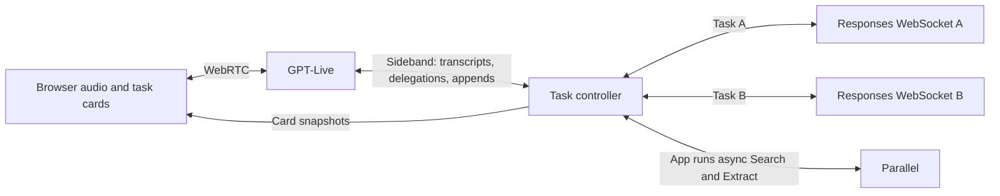

# A voice research assistant you can correct mid-search

Build a voice assistant that researches the web while you keep talking. Ask separate questions, correct one search without interrupting another, and get findings you can hear and check against sources in the browser.

This recipe pairs GPT-Live for voice with a GPT-6 Luna research backend on the Responses API. The research model uses Parallel Search and Extract as tools. It's built on two Responses features that shipped with the GPT-6 Astra release:

- [Asynchronous tool calling](https://developers.openai.com/api/docs/guides/async-tool-calling) lets the model start several searches and keep working. The app runs each search and returns its result as soon as it's ready.
- [Mid-turn steering](https://developers.openai.com/api/docs/guides/steering) sends a correction to a response while it's still running, instead of cancelling it and starting over. Steering only works over a Responses API WebSocket, so each task holds its own socket.

## Run it

You need:

- Node.js 24+
- An OpenAI API key on a paid usage tier with access to the models in [settings.json](https://github.com/openai/openai-cookbook/blob/main/examples/partners/parallel/voice-research/settings.json)
- A Parallel API key
- A browser with a microphone

Follow the [README setup instructions](https://github.com/openai/openai-cookbook/blob/main/examples/partners/parallel/voice-research/README.md) to install dependencies, add your keys, and start the app. Open `http://localhost:3000`, click **Start conversation**, and allow microphone access. Voice is billed for as long as the session is open, so click **End conversation** when you're done. Research-model and Parallel calls are billed separately.

Say, "Find two events in San Francisco this Saturday." Then add, "Separately, compare the current Node.js and Deno releases." While both are running, say, "For the events, make that Sunday and indoors."

You'll see two cards. The event card clears its Saturday findings and shows what the assistant can verify for Sunday. The comparison keeps running. Open the citations to check the date and indoor setting. If the sources don't establish both, the assistant should say so. To check that tasks really are independent, start a fresh run and cancel only the event task. The comparison should keep going.

The code below is excerpted from the app, and each section links to the full file.

## How the pieces fit



GPT-Live handles the conversation. When the user asks for research, it sends the app a *client delegation* over the sideband, a server-side connection to the same voice session that also carries transcripts. The delegation has no task text in it, so the controller makes an interpretation call that turns recent speech into a new task, a revision, a cancellation, or a clarifying question. While any task is researching, the controller also interprets new speech after a short pause, as the [delegation guide](https://developers.openai.com/api/docs/guides/live-delegation) suggests. That way a correction still lands if GPT-Live never delegates it.

Each task has its own ID, Responses WebSocket, and revision counter. The counter goes up every time the user changes the task, and every result carries the revision it belongs to, so a search for an old objective can't update a corrected task. Separate sockets also keep failures contained, since a dropped socket only fails its own task. You could share one socket and give each task a `stream_id` lane, but then one disconnect takes down every task.

Voice instructions live in [src/server.ts](https://github.com/openai/openai-cookbook/blob/main/examples/partners/parallel/voice-research/src/server.ts) and follow the [GPT-Live prompting guide](https://developers.openai.com/api/docs/guides/live-prompting). Research instructions live in `researchPrompt` in [src/research.ts](https://github.com/openai/openai-cookbook/blob/main/examples/partners/parallel/voice-research/src/research.ts).

## Async tools: search without waiting

The research model has two tools, defined in [src/backend.ts](https://github.com/openai/openai-cookbook/blob/main/examples/partners/parallel/voice-research/src/backend.ts). Search returns relevant URLs and excerpts. Extract pulls focused evidence from URLs that the user supplied or a previous search returned. Here's the Search definition:

```typescript
{
  type: "function", name: "parallel_search", async: true, strict: true,
  description: "Search current public web evidence. Use 1-3 keyword queries of at most 200 characters, " +
    "without site: operators; put source preferences in the objective.",
  parameters: {
    type: "object", additionalProperties: false, required: ["objective", "search_queries"],
    properties: {
      objective: { type: "string" },
      search_queries: { type: "array", items: { type: "string" }, minItems: 1, maxItems: 3 },
    },
  },
}
```

With `async: true`, the model can emit several calls and finish its turn while they run. For a comparison, it can start both searches at once. The API doesn't run async tools for you, and the response doesn't stay open while they run. The app starts each search when a complete call item arrives, not from argument deltas:

```typescript
// src/research.ts
case "response.output_item.done":
  if (e.item.type === "function_call") launch(e.item);
```

When a result is ready, the app sends it in the next `response.create` under the original `call_id`, chained to the latest response. Explicit continuations don't inherit settings, so every request restates the same instructions, tools, and output format:

```typescript
// src/research.ts
const result = { type: "function_call_output", call_id, output: job.output! };
// Collect ready result items like this one in input.
send({
  type: "response.create", model: options.model, store: false, /* … */
  instructions: `${researchPrompt}\n\nToday is ${calendar(options.today, 1)[0]}.`,
  tools: [...available, waitTool],
  tool_choice: toolsOff && !pending ? "none" : "auto", text: { format },
  input, previous_response_id: current,
});
```

Tool results have to go in a new response, since `response.steer` only accepts user messages. When the model needs more evidence, it can call the synchronous `wait_for_results` tool. It returns as soon as the first pending retrieval finishes, and the continuation carries every ready result on its original call ID.

If the model answers while searches are still running, the app treats that answer as a partial update. Once nothing is pending, the current response has to give the final answer, either cited or as an explicit `insufficient_evidence` conclusion. The app also caps searches per revision. Each continuation limits `cited_urls` to an enum of URLs returned for the current revision, so every citation points at a source the app actually retrieved.

## Steering: correct a response while it runs

When the user says "Sunday and indoors," the interpreter revises the event task and bumps its revision. If a response is generating with retrieval tools available, the app steers it on the same socket. The correction takes effect when the replacement response starts. Here, `current` is the active response ID, and `objective()` formats the revised task and revision as input:

```typescript
// src/research.ts
send({ type: "response.steer", previous_response_id: current, input: objective() });
```

The server queues the input and sends `response.steer.accepted`. The previous response either finishes normally or ends as `incomplete` with reason `steered`. When the server sends the successor's `response.created`, the app records its ID and assigns its output to the corrected revision.

Steering doesn't cancel tools that are already running. The app aborts the old searches itself and answers their call IDs with a `superseded` marker, never with stale excerpts. Three cases need extra handling:

- **Pending inputs.** If the steered response still needs tool results, the server holds the steer and sends `response.steer.pending` with `required_input`. The app answers once with a `response.create` that carries the superseded markers. It doesn't send the steer again.
- **Inherited instructions.** Automatic successors keep the original request's settings, and instructions outrank a user-role steer. So the objective and revision go in as input, and budgets stay in application code. For the same reason, the app doesn't steer a response whose budget has turned tools off. It lets that response finish, then sends a continuation with tools back on.
- **Failed steers.** For `response_already_completed`, `response_not_active`, `successor_creation_failed`, and `steering_not_supported`, the app sends the latest objective as an ordinary continuation.

If no response is running when the correction arrives, it goes out with the next continuation. With a fast search backend that's common, because corrections tend to land between responses while the app waits on results. The evaluation records which path each correction took, so you can see how often steering was actually used.

## Deliver results to the voice

The research model returns findings in the shape defined by `findingFormat` in [src/research.ts](https://github.com/openai/openai-cookbook/blob/main/examples/partners/parallel/voice-research/src/research.ts): an `outcome` of `supported` or `insufficient_evidence`, a card title, `display_items` with a heading and detail each, and `cited_urls`. The card shows the items with source links, and the app uses those same items for the spoken update. Ordinary findings don't need a second call to write the voice version.

[The controller](https://github.com/openai/openai-cookbook/blob/main/examples/partners/parallel/voice-research/src/controller.ts) publishes a finding only when it belongs to the task's current revision, the task hasn't been cancelled, and all the speech received so far has been interpreted. A correction clears only its own task's card.

The app sends results to GPT-Live on the task's latest delegation ID, labeled "Early result; research is still running" or "Final result" so it knows where the research stands:

- `session.commentary.append` asks Live to say something: the first partial of each revision, a final that adds something new, a withdrawal of earlier advice, and confirmations such as a cancellation.
- `session.thinking.append` adds quiet context: later partials with an unchanged outcome, a final that repeats what was already said, corrections, and the status of a task GPT-Live asks about again.
- The app never uses `session.instructions.append`, because it can interrupt speech.

Live allows 500 tokens per append. [src/live-updates.ts](https://github.com/openai/openai-cookbook/blob/main/examples/partners/parallel/voice-research/src/live-updates.ts) sends short updates directly. For text over 500 UTF-8 bytes, it checks whether the whole update fits with the [input-token counting endpoint](https://developers.openai.com/api/reference/resources/responses/subresources/input_tokens/methods/count). If a two-item update is too long, the app can send each finding separately. For other oversized updates, one tools-free call shortens the wording for speech. An append acknowledgment tells you the context reached the model, not that it was spoken. Listen to the recording to judge what the user actually heard.

Interrupting the assistant only stops speech. Cancelling a task closes its socket, aborts its Parallel calls, and drops its queued results. Other tasks keep running.

## Extend and test

A task is `{ request, location, date, constraints }`. The research instructions keep request-specific guidance under a single "Request types" heading, covering events, news, software documentation, and comparisons. To add another kind of public-web research, add guidance there and try it with representative requests. Anything that needs private data, actions, or new task fields will also need changes to the tools or schema.

For automated checks, install `ffmpeg` and Chromium, then run the tests and typecheck:

```sh
npx playwright install chromium
npm test
npm run typecheck
```

The tests cover the protocol paths deterministically, including steering successors, pending inputs, failure codes, async results on original IDs, budgets, and per-task routing.

Before you switch models, run [scripts/probe-research.ts](https://github.com/openai/openai-cookbook/blob/main/examples/partners/parallel/voice-research/scripts/probe-research.ts) to confirm the new model supports async tools and steering. It runs the same research code against the real API and steers it once, so it makes paid API calls. The [evaluation guide](https://github.com/openai/openai-cookbook/blob/main/examples/partners/parallel/voice-research/evals/README.md) runs the voice scenarios and explains how to grade the recordings for speech quality and perceived latency.
