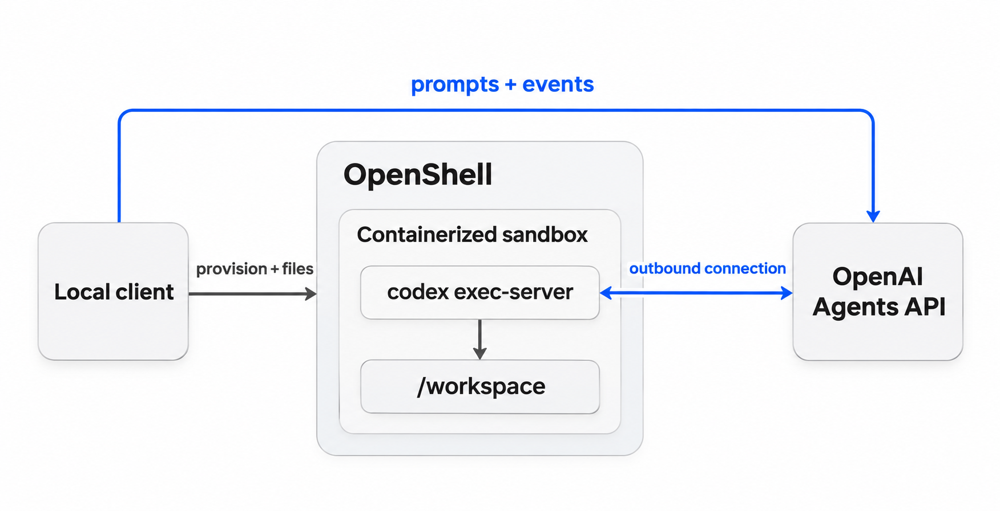

# Sandboxing Codex with NVIDIA OpenShell

For enterprise deployments, [NVIDIA OpenShell](https://docs.nvidia.com/openshell/v0.1.9/)
provides a standard way to enforce a sandbox around agent execution. Codex also
includes built-in sandboxing, but this guide demonstrates another deployment
pattern: run `codex exec-server` inside a fully containerized OpenShell sandbox
controlled by a local client. Prompt submission and model inference remain
outside the sandbox; only shell commands and filesystem operations execute
inside it.

The included terminal app connects an OpenAI Agents API session to the sandbox,
preserves its files across follow-up turns, and downloads artifacts before
deleting the sandbox and session.

## Architecture

The host application creates an Agents API session with a `self_hosted`
environment and `/workspace` as its working directory. OpenAI returns an
environment ID and remote URL. The application passes both values, plus a
restricted environment key, into a new OpenShell sandbox.

Inside the sandbox, `codex exec-server` registers the environment and maintains
the outbound connection used to receive work. The host remains responsible for
the session event stream, operator commands, artifact downloads, and cleanup.



One sandbox belongs to one API session. It stays alive across follow-up turns,
so files created in `/workspace` remain available until the chat ends.

## Prerequisites

You need:

- Node.js 24 or later with npm.
- Docker Engine or Docker Desktop 28 or later.
- OpenShell 0.1.9 with a local gateway that uses the same Docker engine in
  which you build the example image. Review the
  [OpenShell support matrix](https://docs.nvidia.com/openshell/v0.1.9/about/support-matrix)
  and [Docker runtime configuration](https://docs.nvidia.com/openshell/v0.1.9/how-it-works/sandboxes/runtimes#docker-driver)
  for host-specific requirements.
- An OpenAI project with Agents API access and access to the model configured
  in `src/session.ts`.
- Two keys from the same OpenAI organization, project, and owner:
  - `OPENAI_API_KEY` is the application key used by the host. Grant it
    `api.agents.read`, `api.agents.write`, and `api.responses.write`.
  - `OPENAI_EXECUTOR_API_KEY` is an environment key used only to connect the
    executor. Create it in the
    [Agents dashboard](https://platform.openai.com/agents?tab=environments&environment_view=keys)
    and set all other permissions to **None**.

The two keys must be different. See
[environment authentication](https://developers.openai.com/api/docs/guides/agents-api/environments/self-hosted#authentication)
for the security model behind application and environment keys.

## 1. Install and check OpenShell

If OpenShell is not already installed, install the version used by this
example, then confirm that the CLI can reach its gateway.

```bash
curl -fsSL https://raw.githubusercontent.com/NVIDIA/OpenShell/v0.1.9/install.sh |
  OPENSHELL_VERSION=v0.1.9 sh
openshell status
```

For alternative runtimes and platform instructions, see the
[OpenShell installation guide](https://docs.nvidia.com/openshell/v0.1.9/about/installation).

## 2. Set the OpenAI keys

Set both keys in the shell that will start the app. This prompt-based option
keeps them out of your shell history:

```bash
printf 'OpenAI application key: '
read -rs OPENAI_API_KEY
printf '\nOpenAI environment key: '
read -rs OPENAI_EXECUTOR_API_KEY
printf '\n'
export OPENAI_API_KEY OPENAI_EXECUTOR_API_KEY
```

Do not put either key in the image or source files. The app removes OpenAI keys
from the environment of ordinary `openshell` subprocesses and passes only the
environment key to sandbox creation.

## 3. Build and start the example

From the Cookbook repository root, build the executor image, install the host
dependencies, compile the TypeScript, and start the chat:

```bash
cd examples/agents-api-openshell
docker build -t cookbook/agents-api-openshell:local .
npm ci
npm run build
npm start
```

Startup creates the API session and a sandbox named `agent-os-<random-id>`.
Wait for `Executor connected` before entering a prompt.

## 4. Create and download an artifact

At the `you>` prompt, ask the agent to create a file in the workspace:

```text
Write exactly "hello from OpenShell" followed by a newline to /workspace/outputs/hello.txt. Read the file and tell me what it contains.
```

After the turn completes, download the file through OpenShell:

```text
/download outputs/hello.txt
```

The app creates a private, uniquely named directory under `downloads/` and
prints the local path. `/download` accepts either a path relative to
`/workspace` or an absolute path beneath it. It rejects traversal segments and
paths outside the workspace.

You can then send a follow-up prompt such as: `Count the lines in the file you
just wrote.` The new turn uses the same session and sandbox.

The terminal supports four operator commands:

| Command | Action |
| --- | --- |
| `/status` | Print the API session, sandbox, executor, and turn status. |
| `/logs` | Print the latest 60 lines of sandbox logs. |
| `/download <path>` | Copy a file or directory from `/workspace` to `downloads/`. |
| `/quit` | Cancel active work, delete the sandbox and API session, and exit. |

Files from a self-hosted environment belong to its runtime provider; they are
not automatically uploaded as OpenAI-managed artifacts. This example therefore
uses OpenShell's file-transfer command. For the general model, see
[Files and artifacts](https://developers.openai.com/api/docs/guides/agents-api/environments/files)
and [OpenShell file transfer](https://docs.nvidia.com/openshell/v0.1.9/how-it-works/sandboxes/overview#transfer-files).

## Follow the implementation

The reference implementation separates API orchestration from sandbox
operations:

- [`src/session.ts`][session-source] creates the self-hosted Agents API session,
  consumes the event stream, submits input, tracks turns, and coordinates
  shutdown.
- [`src/openshell.ts`][openshell-source] wraps the OpenShell CLI and validates
  workspace paths.
- [`src/events.ts`][events-source] reduces SDK events to the text, command, and
  lifecycle updates shown in the terminal.
- [`src/cli.ts`][cli-source] implements the interactive prompt and operator
  commands.
- [`policy.yaml`][policy-source] defines the filesystem, process, and network
  boundary applied to the sandbox.

The startup order in `SandboxSession.start()` is intentional:

1. Create an Agents API session with `environment.type` set to `self_hosted`.
2. Open the session event stream before starting the executor, so the app does
   not miss its connection event.
3. Create the OpenShell sandbox with the environment ID, remote URL, and
   restricted key supplied through `--env-from`.
4. Wait for `agent.session.environment.connected` before accepting a prompt.
5. Submit each user message with an idempotency key and wait for both the root
   turn outcome and a subsequent idle event.

This ordering is useful beyond OpenShell: an application-managed provider must
connect its executor to the exact environment returned for the session and
must keep observing lifecycle events while that executor is running. See the
[self-hosted sandbox guide](https://developers.openai.com/api/docs/guides/agents-api/environments/self-hosted)
and [session events guide](https://developers.openai.com/api/docs/guides/agents-api/sessions/events).

## Understand the sandbox boundary

The example's policy is intentionally narrow:

- The executor runs as UID and GID 1000 with OpenShell's seccomp filtering and
  Landlock set to `hard_requirement`.
- `/workspace` is writable. Selected system and executor paths are read-only.
- Only `/opt/codex/bin/codex` and its descendants may connect to
  `api.openai.com:443` and `codex-cloud-environments.chatgpt.com:443`.
- Other outbound connections are denied unless the gateway administrator
  applies a broader global policy.

The two allowed endpoints use TLS passthrough, so OpenShell authorizes the
connection while its contents remain encrypted. Review
[OpenShell network rules](https://docs.nvidia.com/openshell/v0.1.9/how-it-works/policies/network-rules)
before adapting the policy for other tools or destinations.

The host's `OPENAI_API_KEY` is never injected into the sandbox. The restricted
environment key is available there as `CODEX_API_KEY`, which means sandboxed
code can read it even though the terminal redacts key-shaped output. Treat the
sandbox and all model-visible tool results as untrusted, and use only
non-sensitive files in this demonstration.

## Cancellation, timeouts, and cleanup

During an active turn, press Ctrl-C once to request cancellation. Press it
again to exit while cancellation is pending. When the app is idle, Ctrl-C exits
immediately. `/quit` is the normal shutdown path.

The implementation allows 75 seconds for the executor to connect, 180 seconds
for a turn to finish, and 30 seconds for a disconnected executor to reconnect.
If the API event stream closes, the app ends the local chat because that stream
cannot replay missed events.

Shutdown first tries to cancel active work, then deletes the sandbox and API
session. Deletion is retried for bounded transient failures. If the process was
killed or cleanup could not be confirmed, use the sandbox name and session ID
printed by `/status`:

```bash
openshell sandbox delete YOUR_SANDBOX_NAME
node --input-type=module - YOUR_SESSION_ID <<'JS'
import OpenAI from "openai";

const client = new OpenAI({ baseURL: "https://api.openai.com/v1" });
const result = await client.beta.agents.sessions.delete(process.argv[2]);
console.log(result.deleted);
JS
```

If session deletion reports active execution, cancel the turn before retrying.

## Test the example

The local checks compile the project and exercise command parsing, event
reduction, redaction, turn tracking, retries, and cleanup without calling
external services:

```bash
npm run typecheck
npm test
```

The opt-in integration test performs billed model inference and creates a real
OpenShell sandbox. It writes and downloads a unique file, then verifies that
the policy denies an unrelated request to `example.com`:

```bash
RUN_OPENAI_OPENSHELL_INTEGRATION=1 npm run test:integration
```

Run the integration test only after building the image and exporting both
OpenAI keys.

[session-source]: https://github.com/openai/openai-cookbook/blob/main/examples/agents-api-openshell/src/session.ts
[openshell-source]: https://github.com/openai/openai-cookbook/blob/main/examples/agents-api-openshell/src/openshell.ts
[events-source]: https://github.com/openai/openai-cookbook/blob/main/examples/agents-api-openshell/src/events.ts
[cli-source]: https://github.com/openai/openai-cookbook/blob/main/examples/agents-api-openshell/src/cli.ts
[policy-source]: https://github.com/openai/openai-cookbook/blob/main/examples/agents-api-openshell/policy.yaml
