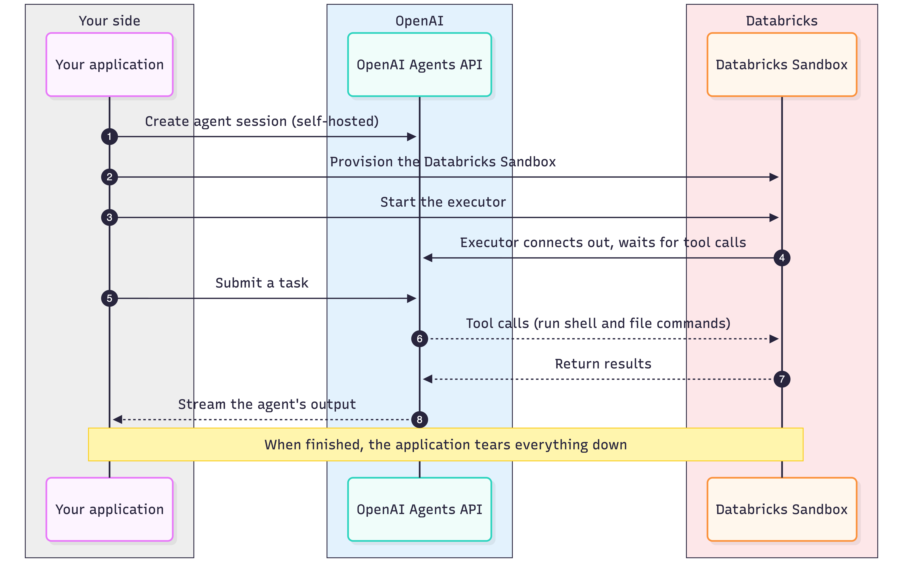

# Running OpenAI agents using a Databricks Sandbox

[Databricks Sandbox](https://docs.databricks.com/aws/en/compute/serverless/sandbox) now supports the [OpenAI Agents API](https://developers.openai.com/api/docs/guides/agents-api/overview), enabling developers to run AI agent code and tool calls in an isolated, serverless environment backed by Databricks' networking and governance controls.

With this integration, OpenAI handles agent orchestration while Databricks Sandbox provides on-demand compute for executing code and interacting with tools and enterprise resources. Developers can control network connectivity and file access, bringing agent execution into an environment designed for enterprise workloads.

In this guide, we'll walk through [application-managed](https://developers.openai.com/api/docs/guides/agents-api/environments/lifecycle#start-an-environment) sandbox provisioning, where your application uses the Databricks SDK to provision and manage the sandbox lifecycle, from creation and execution to cleanup.

## How it works

Your application is in the driver's seat for the whole session. It creates the agent session, provisions the sandbox, launches the executor, runs the turn, and tears everything down - all through outbound calls (to OpenAI and to the Databricks SDK). Nothing needs to accept an inbound connection, so the application can run anywhere: a laptop, a Databricks job, or a notebook.

The lifecycle:

- Create an agent session with self-hosted environment configuration.
- Provision the sandbox and poll its status to confirm the sandbox is running. The sandbox already has a codex binary built in.
- Launch `codex exec-server` inside the sandbox; it connects outbound to OpenAI and waits for tool calls.
- Submit input and stream the turn; the agent runs shell and file tools in the sandbox.
- Tear down the session and the sandbox.



## Usage example with Databricks SDK

The agent session is created with the OpenAI client, pointing its `workspace_directory` at a writable path in the sandbox. Your application can use `databricks-sdk` for sandbox lifecycle management and command execution.

`codex exec-server` must stay running on the sandbox for the whole agent session. Your application can launch the process detached using `execute_command_sync`, which lets the command-execution request return while the codex process keeps running on the sandbox.

```py
import os

w = WorkspaceClient(profile="my-workspace")
app_key = os.environ["OPENAI_API_KEY"]                    # application key
executor_api_key = os.environ["OPENAI_EXECUTOR_API_KEY"]  # environment key -> CODEX_API_KEY


async with AsyncOpenAI(api_key=app_key) as client:
    # Create the self-hosted session first; it returns the environment to connect back to.
    session = await client.beta.agents.sessions.create(
        agent={"model": "gpt-5.6-sol"},
        environment={"type": "self_hosted", "workspace_directory": WORK_DIR},
    )

    # Provision the sandbox via databricks-sdk.
    # Sandboxes typically become ready within sub-seconds.
    sandbox = w.sandbox.create_sandbox(
        Sandbox(
            spec=SandboxSpec(
                compute=ComputeSpec(inactivity_timeout=Duration(seconds=900)))
        ),
        sandbox_id="openai-agent-sandbox",
    )
    name = sandbox.name

    # Launch codex exec-server detached, using the session's environment id/URL.
    remote_url = session.environment.remote_url
    environment_id = session.environment.id
    w.sandbox.execute_command_sync(
        name, "/bin/bash",
        args=["-lc", f"CODEX_HOME=$(mktemp -d) setsid nohup codex exec-server "
              f"--remote {remote_url} --environment-id {environment_id} </dev/null >log 2>&1 & echo pid=$!"],
        envs={"CODEX_API_KEY": executor_api_key},
    )

    # Submit input and stream the turn.
    async with client.beta.agents.sessions.stream(session.id, input=task) as events:
        async for event in events:
            ...  # agent runs tools in the sandbox and streams output
```

See the complete, runnable example in the [application-managed example](application_managed/README.md).

## Prerequisites and limits

- An OpenAI application key (`OPENAI_API_KEY`) for creating sessions and submitting input.
- A separate OpenAI executor key (`OPENAI_EXECUTOR_API_KEY`) with the same organization, project, and user or service account as the session. It is passed to codex in the sandbox as `CODEX_API_KEY`.
- If your OpenAI organization enforces an IP allowlist, the sandbox's egress IP must be added to the allowlist; Managed Agents then rejects traffic from unregistered IPs. See [Databricks Outbound IPs](https://docs.databricks.com/aws/en/resources/ip-domain-region#outbound-ips) for the list of Databricks IPs that need to be allowlisted.

## Ending a turn

A turn is finished when the session stream reports the main agent's turn as completed, failed, or cancelled. Read back any results you need from the sandbox with `execute_command_sync`, then clean up the resources: stop the executor, delete the session, and delete the sandbox.

## Stopping and restarting the sandbox between turns

To free compute between turns, stop the sandbox after the turn with `w.sandbox.stop_sandbox(name)` and start it again before the next turn with `w.sandbox.start_sandbox(name)`.

The sandbox's persistent home (`/home/sandbox-agent`) survives stop and start, so any files under this directory are preserved. The `codex exec-server` process is killed when a sandbox stops, and needs to be relaunched after sandbox restart to reconnect to the agent session.

A sandbox can also be configured to auto-stop after it has been idle for `ComputeSpec.inactivity_timeout`. To disable sandbox auto-stop, set `inactivity_timeout` to 0 or leave the field unset.

## Networking

A sandbox has unrestricted outbound egress and closed inbound ingress. Both are currently unconfigurable.

If your OpenAI organization enforces an IP allowlist, add the sandbox's outbound egress IP (see [Databricks Outbound IPs](https://docs.databricks.com/aws/en/resources/ip-domain-region#outbound-ips)). The egress IP is stable while a sandbox is running but can change across stop and restart cycles.

## Monitoring

The executor writes a log inside the sandbox; read it with `execute_command_sync` (tail the exec-server log) to see registration and connection status or errors.

You can examine the state of a sandbox with `w.sandbox.get_sandbox(name).status.state`.

## Troubleshooting

| Symptom | What to check |
| --- | --- |
| Executor rejected with `401 ... IP is not authorized` | The sandbox egress IP is not on your OpenAI organization allowlist (if your org enforces one). Add it, then re-check after a restart - the egress IP can change across stop/restart. |
| Executor rejected with `403 missing required scope api.agents.environments.connect` | The executor is using a general API key. Create a dedicated environment key on the OpenAI Agents tab and pass it as `CODEX_API_KEY`. |
| `codex exec-server` exits right after launch | Tail the executor log in the sandbox. Check the environment id, remote URL, key ownership, and outbound network access. |
| Agent reports that shell or filesystem tools are unavailable | `workspace_directory` does not exist or is not writable. Create it (under `/home/sandbox-agent`) before the turn. |

## Related resources

- [Databricks Sandbox documentation](https://docs.databricks.com/aws/en/compute/serverless/sandbox)
- [Sandbox SDK on databricks-sdk for Python](https://databricks-sdk-py.readthedocs.io/en/latest/workspace/sandbox/sandbox.html)
- [Running commands in sandboxes](https://databricks-sdk-py.readthedocs.io/en/latest/sandbox-command-execution.html)
- [OpenAI Agents API, self-hosted sandboxes](https://developers.openai.com/api/docs/guides/agents-api/environments/self-hosted)
