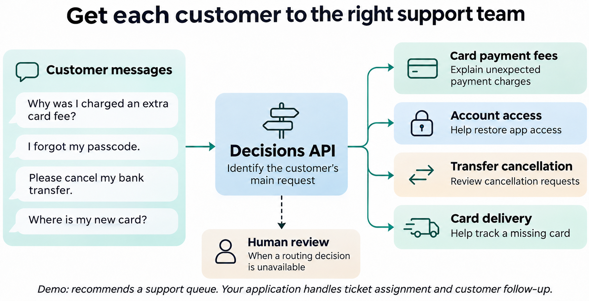

# Route customer-support messages with the Decisions API

The [Decisions API](https://developers.openai.com/api/docs/guides/decisions)
turns text and images into decisions your application can use, about **10× faster
than the Responses API**. It also accepts JSON input. Use it to classify content,
route requests, or score inputs against a rubric.

In this example, you'll route ten banking-support messages to four specialist
queues. You'll define a `choice` question, inspect the API's answers, and extract
a queue and confidence for each message. The example uses **`gpt-6-luna`**.

Open the [notebook](customer_request_routing.ipynb) for the walkthrough, or
[run the terminal demo](#run-the-demo) to try it immediately.

## What you'll build

A support router turns a customer's description into a queue your application can
assign. The question defines each queue's scope so the model can distinguish, for
example, a forgotten app passcode from a blocked card PIN.

| Customer message | Intended queue |
| --- | --- |
| "I was charged a fee for a card payment. Why?" | `card_payment_fees` |
| "Tell me how to reset the passcode." | `account_access` |
| "I need to cancel an incorrect transaction." | `transfer_cancellation` |
| "How long should my new card take to arrive?" | `card_delivery` |



The demo prints a recommendation; your application handles ticket assignment.
Only the message and question go to the model. Dataset labels stay local.

## Run the demo

You'll need Python 3.10+, Bash, and an OpenAI project API key with Decisions
access. The Python helpers use only the standard library. For the notebook,
use Jupyter or VS Code with a Python kernel.

From the repository root, run:

```bash
bash examples/decisions/run_demo.sh
```

Enter your API key at the hidden prompt, or use an existing `OPENAI_API_KEY`
environment variable. Keep keys out of source files, notebook cells, and shared
output. Each full run makes **ten billable API requests**; check
[current pricing](https://developers.openai.com/api/docs/guides/decisions#pricing-and-availability).

For each message, the demo prints the request, response JSON, selected queue,
confidence, and elapsed time. A full run finishes at `Example 10/10`.

To route one message instead:

```bash
bash examples/decisions/run_demo.sh --message "I forgot my app passcode."
```

With `OPENAI_API_KEY` already set, you can also run
`python3 examples/decisions/run_customer_request_routing.py` directly.

### Use the notebook

Open [customer_request_routing.ipynb](customer_request_routing.ipynb), select a
Python 3.10+ kernel, and choose **Run All**. Start the kernel in the repository
root or `examples/decisions/`. It displays the request and prompts for a key if
`OPENAI_API_KEY` is unset, then makes the same ten requests as the terminal demo.

## How the request works

Each request contains a `model`, an `input` message, and a `questions` array.
The shared [routing helper](routing.py) supplies one question named `route` with
four choices and descriptions. The API echoes the question name in its answer.

| Question type | Use it for |
| --- | --- |
| `choice` | Selecting a category, such as a support queue |
| `predicate` | Estimating whether a condition holds |
| `score` | Rating input against ordered levels |

This example uses `choice` because queues are categories without an order.
For custom JSON objects such as extracted fields, use
[Structured Outputs](https://developers.openai.com/api/docs/guides/structured-outputs)
with the Responses API instead. See the
[Decisions reference](https://developers.openai.com/api/reference/resources/decisions/methods/create)
for the full request and response schema.

## Read the result

A choice answer contains `choice`, per-choice `probabilities`, and a separate
`confidence` value. The parser checks the answer's type, question name, allowed
queue, and confidence range before returning a route.

For a card-delivery message, a terminal summary could look like this
(illustrative values, not a recorded API response):

```json
{
  "route": "card_delivery",
  "confidence": 0.92,
  "latency_ms": 180.0
}
```

A refusal or unusable answer produces `"route": "human_review"` and
`"confidence": null`. HTTP, network, and invalid-JSON errors stop the run.
Requests reject redirects, use a 30-second timeout, and have no automatic retries.
Check failures before rerunning: the API may already have processed a request.
Latency includes connection setup and network time.

## Adapt it to your application

Edit `QUESTION` in [routing.py](routing.py) to change the queues and their
descriptions. The parser reads the allowed values from that same question.
Try your own inputs with `--message` while refining queue ownership.

The four queues assume an in-scope request. For broader traffic, add an `other`
choice or a separate scope check before assigning a ticket. Confidence does not
guarantee correctness: evaluate representative labeled messages before choosing
review thresholds or enabling actions. The ten public examples demonstrate the
workflow, not production accuracy.

## Files and tests

| File | Purpose |
| --- | --- |
| [customer_request_routing.ipynb](customer_request_routing.ipynb) | Guided walkthrough |
| [routing.py](routing.py) | Question, HTTP request, and response validation |
| [customer_requests.json](customer_requests.json) | Ten messages and source metadata |
| [run_customer_request_routing.py](run_customer_request_routing.py) | Terminal runner |
| [run_demo.sh](run_demo.sh) | Launcher with hidden key input |
| [test_customer_request_routing.py](test_customer_request_routing.py) | Offline application tests |

Run the tests without making API calls:

```bash
python3 -m unittest discover -s examples/decisions -p 'test_*.py'
```

## Data and attribution

The ten messages come from [BANKING77](https://github.com/PolyAI-LDN/task-specific-datasets/tree/57ec275d8078af65b7731c2a98be812d844a6d6b/banking_data),
published by PolyAI under [CC BY 4.0](https://creativecommons.org/licenses/by/4.0/)
(Casanueva et al., 2020, [paper](https://arxiv.org/abs/2003.04807)). Original wording
and labels are retained. [customer_requests.json](customer_requests.json) records
the authors, pinned source, and checksum. No dataset download is needed.
