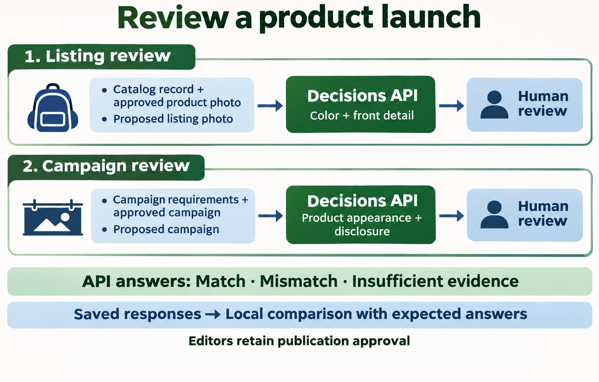

# Review product listings and campaigns with the Decisions API

The [Decisions API](https://developers.openai.com/api/docs/guides/decisions) answers focused questions about text, images, and JSON. You provide evidence and checks; the API returns typed answers. This notebook uses choice questions with three outcomes: `match`, `mismatch`, and `insufficient_evidence`.

## Why Decisions API for this workflow?

The application uses defined outcomes for visual checks, with per-choice probabilities and confidence. Decisions supports independent questions over shared JSON and image evidence, with proposed images attached to the questions. This fits a product-review workflow whose output is a status for each requirement.

A general-purpose model with [Structured Outputs](https://developers.openai.com/api/docs/guides/structured-outputs) can also return schema-constrained classifications. Use that path when the application also needs generated explanations or copy. This recipe focuses on the dedicated decision interface and does not claim guaranteed accuracy or determinism.

## The use case

A retailer is launching a navy backpack. Suppliers submit listing photos, and designers submit campaign variants. An editor needs to catch incorrect product details and missing text while accepting harmless creative changes.

| Stage | Reference and requirements | Proposed asset | API checks |
| --- | --- | --- | --- |
| Listing review | Catalog record and approved product photo | Supplier's product photo | Color and front-pocket configuration |
| Campaign review | Campaign requirements and approved creative | Designer's campaign variant | Product appearance and required disclosure |



We keep one product and one campaign reference fixed so each change is easy to inspect. In an application, select records using the submitted asset's product and campaign IDs. Nine examples use small changes to the same backpack: a correct listing, different color, changed pockets, cropped detail, permitted campaign layout change, altered campaign product, missing disclosure, unreadable disclosure, and combined pocket and disclosure changes.

The notebook writes out the complete listing and campaign request bodies, including `input_json` business records, approved reference images, and proposed images in question instructions. Later examples reuse those visible requests with different submissions. Direct `client.decisions.create(**payload)` calls, response parsing, and the review rule remain in the notebook. Small helpers handle image encoding, readable output, and the application review step.

## Run the notebook

Use Python 3.11 or later. For first-time setup, run from the repository root:

```bash
python3 -m venv .venv
.venv/bin/python -m pip install -r examples/decisions/product_content_review/requirements.txt
```

To set your key in zsh, run this in Terminal before starting Jupyter. Paste the key at the hidden prompt, not into the command itself:

```bash
read -rs "OPENAI_API_KEY?OpenAI API key (hidden): "
export OPENAI_API_KEY
echo
```

Start Jupyter from that same Terminal so the notebook inherits the variable. If Jupyter is already running, use the notebook's hidden prompt or restart Jupyter from that Terminal.

If your environment is already set up, start the notebook directly:

```bash
.venv/bin/python -m jupyterlab examples/decisions/product_content_review/product_content_review.ipynb
```

Select that Python environment and run the cells in order. The notebook prints “Found OPENAI_API_KEY in the environment.” when the variable is set; otherwise, it asks for an authorized project key at a hidden prompt without displaying or saving it. The project must have access to `gpt-6-luna`.

**Run All makes nine API requests, two questions per request.** Re-running an API-call cell makes another API request. Automatic retries and redirects are disabled. See [API pricing](https://developers.openai.com/api/docs/pricing). If a call fails, inspect the error before running it again.

Each example shows **reference and proposed images → expanded request before sending → actual API response → result table → application review step**. Base64 bytes are omitted only from the displayed request. Display thumbnails are smaller for readability; the API receives the original images. Requests and responses appear as expanded JSON. Save the notebook to retain the actual outputs.

## Adapt the workflow

`cases.json` contains fictional catalog records, campaign requirements, and submitted image paths. Replace its catalog records, campaign requirements, reference paths, and proposed assets with data from your existing systems. The notebook's listing and campaign question patterns can be reused with those records.

Application code chooses a review step from the API answers. A mismatch goes to an editor; unclear or unusable evidence requests a better image; all matches proceed to editor review. The editor approval step is a sample application policy, not an API requirement; map outcomes to your own publishing controls. Probabilities and confidence are model outputs, not guarantees of correctness.

## Files

| File | Purpose |
| --- | --- |
| [product_content_review.ipynb](product_content_review.ipynb) | Complete use-case implementation and visual walkthrough. |
| [cases.json](cases.json) | Fictional catalog, campaign requirements, and nine submitted assets. |
| [images/](images/) | Approved references, proposed variants, architecture image, and provenance. |
| [requirements.txt](requirements.txt) | Dependencies for running the notebook. |

The fictional images were generated for this recipe; no retailer photos or private customer records are included. The disclosure is a demonstration requirement, not legal guidance. See [image provenance](images/provenance.json) and the [API reference](https://developers.openai.com/api/reference/resources/decisions/methods/create).
