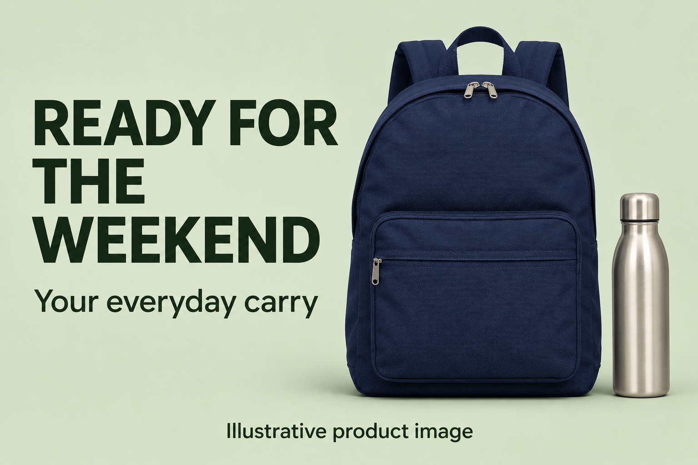
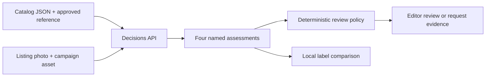

# Review product listings and campaign assets with the Decisions API

A catalog team needs to catch content mistakes before publication: a listing photo from another product, a campaign that changes the product's appearance, or required copy that disappears from an asset. A single “looks good” assessment hides which requirement failed.

This example combines catalog JSON, an approved reference photo, and candidate listing and campaign images. The [Decisions API](https://developers.openai.com/api/docs/guides/decisions) answers four separate `choice` questions in one request. Python uses those assessments to suggest an editor's next step and compares them with local labels.



## What you will build



The shared input contains catalog data as `input_json` and the reference as `input_image`. Each question's `instructions` contains a criterion and its own candidate image. These are the features used: JSON input, shared evidence, images in question instructions, multiple questions, and fixed `choice` answers with probabilities and confidence. Token usage is saved from each response. There is no router or publishing integration.

| Check | Requirement |
| --- | --- |
| `listing_color` | The visible bag color agrees with the catalog. |
| `listing_detail` | The specified front pocket or patch is visible. |
| `campaign_product` | The campaign preserves the reference product's color and front configuration. |
| `campaign_disclosure` | The complete asset visibly contains the required disclosure. |

Every check allows `match`, `mismatch`, or `insufficient_evidence`. A closed package cannot establish the color of its contents; a rear view cannot establish a front detail. Missing or refused answers remain unusable rather than becoming matches. Confidence is a model signal, not a guarantee of correctness.

## Setup

Use Python 3.11 or later and a work or other authorized project API key with access to `gpt-6-luna`. From the repository root:

```bash
python3 -m venv .venv
.venv/bin/python -m pip install -r examples/decisions/product_content_review/requirements.txt
```

The example reads `OPENAI_API_KEY`, or asks for it at a hidden Terminal prompt. It does not save the key. Do not paste it into the notebook source or a committed file. If your network uses a SOCKS proxy and reports a missing `socksio` package, install `socksio` in the same environment.

Each case makes **one paid request with four questions**, using `POST https://api.openai.com/v1/decisions`. The default CLI run uses one case; `--all` uses eight. The notebook uses all eight. See [API pricing](https://developers.openai.com/api/docs/pricing) before running. Actual token usage appears in each saved response. Requests are spaced 5 seconds apart, including the transition between CLI and notebook validation. Change `REQUEST_DELAY_SECONDS` in `review.py` if your project needs more time between calls. Pacing reduces rate pressure; it does not override project limits or replenish quota. Automatic retries and HTTP redirects are disabled.

## Run as Python

Start with one case:

```bash
.venv/bin/python -u examples/decisions/product_content_review/run_review.py
```

Then run all eight cases:

```bash
.venv/bin/python -u examples/decisions/product_content_review/run_review.py --all
```

To inspect one particular case, use `--case case_06`. Commands work from any directory when the script's absolute path is used; local files resolve relative to the example, not your shell directory.

Each case prints the request fields, actual API response, and suggested next step. Base64 image bytes are omitted from printed requests; the API receives the complete images. Results are replaced cleanly on rerun in `results/latest/`:

- `report.html`: side-by-side images, assessments, request, and response. Open it directly in a browser.
- `results.json`: completed live results, saved after every successful request.
- `metrics.json`: comparison against local labels, written only after the complete batch succeeds.

If a call fails, the process stops without retrying and retains completed cases. Inspect the error and project access before rerunning; a rerun starts a new paid batch. `--output PATH` selects a different result directory.

## Run the notebook

Install the notebook dependencies in the same environment:

```bash
.venv/bin/python -m pip install -r examples/decisions/product_content_review/requirements-dev.txt
```

Open `product_content_review.ipynb` in VS Code, select the repository's `.venv` Python kernel, and run from top to bottom. The kernel's working directory should be this example's directory. The notebook prompts for the key if needed, shows all three images for the first case, makes the direct SDK call, and displays actual requests and responses for the remaining cases. **Run All makes eight paid requests.** It saves a separate report in `results/notebook/`.

Both entry points call the same builder and parser. The notebook exposes `client.decisions.create(**payload)` directly so you can see the API boundary. The published notebook has cleared cell outputs; its Markdown includes an answer captured from a live run, and running it shows your actual results.

## How the files connect

| File | Responsibility |
| --- | --- |
| `product_content_review.ipynb` | Readable tutorial, evidence inspection, direct live API call, batch and label comparison. |
| `run_review.py` | CLI, progress, readable requests/responses, and saved results. |
| `review.py` | Native SDK client, request construction, answer parsing, review policy. |
| `report.py` | Local HTML evidence report with escaped text and embedded images. |
| `evaluate.py` | Local comparison of saved answers with labels; no additional API calls. |
| `cases.json` | Fictional catalogs, approved references, candidate images and photo-view metadata. |
| `labels.json` | Author-reviewed expected assessments, never sent to the API. |
| `images/` | Original generated fixtures and their provenance. |
| `test_review.py` | Local regression checks, including a simulated SDK transport. |
| `verify_live.py` | Contributor check that executes both actual entry points with a live key. |

The review policy flags any mismatch for an editor. With no mismatch, uncertainty or an unusable answer requests better evidence. All matches suggest `ready_for_editor_review`. No outcome publishes content automatically, and unresolved checks remain visible when a mismatch takes priority.

## Understand the label comparison

To compare a saved run again without paying for more requests:

```bash
.venv/bin/python examples/decisions/product_content_review/evaluate.py \
  examples/decisions/product_content_review/results/latest/results.json
```

Metrics include total checks, agreements, missed mismatch flags, false mismatch flags, unclear evidence marked as a match, unusable answers, and labeled-mismatch cases suggested as editor-ready. Counts include their denominators: total checks, labeled mismatches and labeled unclear checks.

The eight author-reviewed fixtures illustrate the integration. They are grouped by product, not independent development and test splits; images are deliberately reused to isolate changes. Results do not establish production accuracy, confidence calibration, or legal compliance. Inspect disagreements instead of changing labels to fit predictions. For deployment, collect representative supplier images, label them with domain reviewers, separate development and held-out products and image sources, and evaluate a frozen policy against the cost of missed defects and unnecessary review.

## Contributor validation

Local checks make no network requests:

```bash
.venv/bin/python -m unittest discover \
  -s examples/decisions/product_content_review -p 'test_*.py' -v
```

To execute both the CLI and the actual notebook with the same live key:

```bash
.venv/bin/python -u examples/decisions/product_content_review/verify_live.py
```

This command prompts securely if needed and makes **16 paid requests**, eight through each entry point. It uses the current Python environment for the notebook kernel. Inspect `results/cli/`, `results/notebook/`, and `results/live_validation.json`. Completion verifies execution; label agreement is reported separately and is not assumed. An executed notebook is saved under `results/notebook/`; generated results stay untracked.

## Data and image provenance

The products, catalogs and required disclosure are fictional. Six original images were generated with OpenAI image generation for this tutorial; no retailer photography, private customer records, or real brand guidelines are included. The disclosure is an example criterion rather than a legal requirement. Image hashes and provenance are recorded in `images/provenance.json`.

The gold labels were assigned by inspecting the fixtures. Photo-view metadata states whether the listing shows a front, rear, or packaged view. Treat production metadata as trustworthy only when your capture pipeline establishes it. This workflow assesses visible evidence, not hidden materials, dimensions, authenticity, or compliance.
