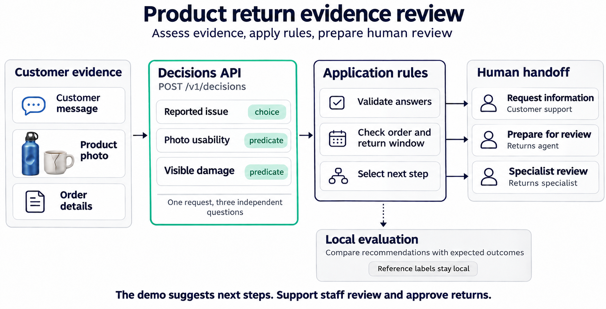
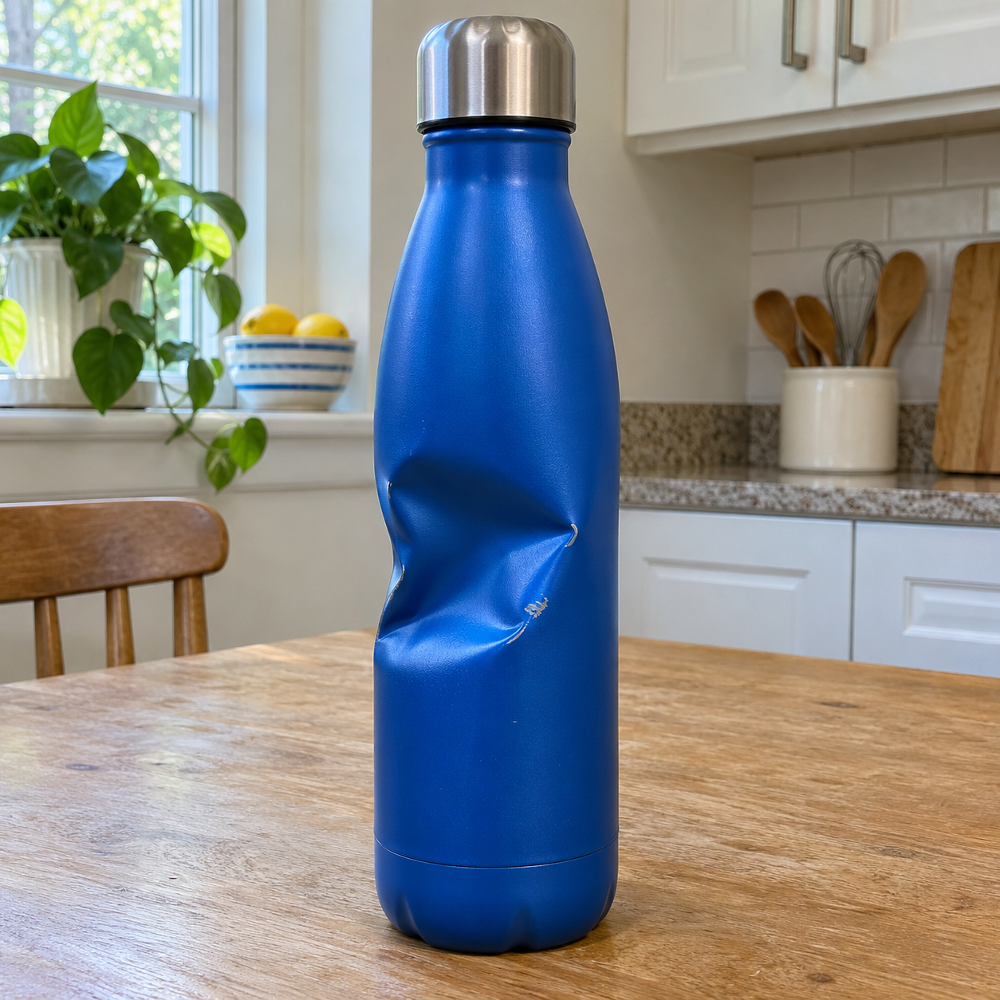
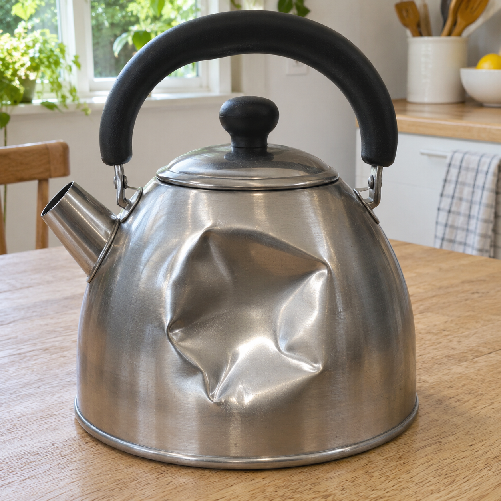

# Evaluate product-return evidence with the Decisions API

Support teams need usable evidence before handling a return. This example combines
a customer's message, a product photo, and order JSON to assess a return request,
then prepares a next step for a person. It includes ten fictional cases and seven
synthetic illustrative photos, including a conversation before and after clarification.

The [Decisions API](https://developers.openai.com/api/docs/guides/decisions)
evaluates evidence and returns typed answers. Each request uses `gpt-6-luna` at
`POST https://api.openai.com/v1/decisions` with three independent questions:

| Question | Type | Evidence assessed |
| --- | --- | --- |
| `reported_issue` | `choice` | The customer's stated return reason |
| `photo_usable` | `predicate` | Whether the latest photo clearly shows the product |
| `visible_damage` | `predicate` | Whether product damage is visible, excluding packaging |

In a real application, load order details from your authenticated order system;
customer-supplied dates do not establish return eligibility.

Application code uses those answers to request information, prepare a case for
agent review, or recommend specialist review. Every prepared return requires a
person's approval. Handoff records identify proposed queues; no tickets are sent
and no refunds are issued.

## Workflow



## Run with Python

Use Python 3.10+. The Python runner and shared modules use only the standard
library, so this path needs no notebook packages. Start in your cloned
`openai-cookbook` repository and run:

```bash
python3 -u examples/decisions/product_returns/run_product_return_evidence.py
```

A full run makes **ten paid API requests**, one per case. Each request contains
all three questions; grading makes no additional calls. Running the notebook
separately makes another ten requests.

Enter the key at the hidden prompt if `OPENAI_API_KEY` is unset. The runner prints
each request with image bytes omitted, followed by the actual response, local
handoff record, and expected-outcome check. It saves these local files after each
completed case:

- `outputs/product-return-results.html`: self-contained report with photos, request previews, and responses.
- `outputs/product-return-results.json`: request previews, actual responses, cases, handoffs, and checks.

Open the HTML file in your browser. On macOS:

```bash
open outputs/product-return-results.html
```

Use `--output /path/to/report.html` to change the destination. The path must end
in `.html`; output paths that would overwrite bundled JSON data are rejected. Each run resets
that report and its adjacent JSON file before its first request, then updates them
as cases complete. Exit status is zero
when all ten expected outcomes match and nonzero on a mismatch or request error.

Requests use a 30-second timeout, reject redirects, and do not retry automatically.
On a request failure, the run stops and retains completed-case reports. A failed
request may already have been processed. Inspect the error before rerunning;
another full run makes ten new paid requests. `--help` does not prompt for a key
or call the API.

## Run in a notebook

The notebook uses the same shared modules and adds inline image display and an
evaluation table. Choose either JupyterLab in a browser or VS Code.

### JupyterLab in a browser

Use a Python 3.10+ project environment. If you already have a working Jupyter
installation, use it. Otherwise, from the repository root:

```bash
python3 -m venv .venv
.venv/bin/python -m pip install jupyterlab ipykernel
.venv/bin/jupyter lab --no-browser
```

Open the local URL printed in Terminal and leave the server running. In the file
browser, open `examples/decisions/product_returns/product_return_evidence.ipynb`.
Select its Python kernel, then choose **Run > Run All Cells**. Stop the server
with Ctrl+C in Terminal when finished.

### VS Code

Open [product_return_evidence.ipynb](product_return_evidence.ipynb), choose
**Select Kernel**, and select your project environment. That environment needs
`ipykernel`; installing it into `.venv` uses this command from the repository root:

```bash
.venv/bin/python -m pip install ipykernel
```

Select **Run All**. If the helper files changed since the last run, reload the
notebook from disk and restart the kernel to load the current code. Save any
unsaved work separately before reloading.

For either notebook interface, the kernel must start in the repository root or
`examples/decisions/product_returns/`. Supply `OPENAI_API_KEY` through the kernel's
environment or the hidden prompt. The notebook displays each photo and conversation,
request JSON with image bytes omitted, actual response JSON, handoff record,
and final evaluation table.

Both entry points save HTML and JSON reports. Output paths are relative to the
working directory: the documented Python command writes to the repository's
`outputs/` folder, while Jupyter normally starts the kernel beside the notebook
and writes to `examples/decisions/product_returns/outputs/`. The notebook prints
the report's absolute path. A fresh full run replaces the report at that path.

Each full run makes **ten paid requests**. The three questions share each request,
and local grading makes no additional calls. See [current pricing](https://developers.openai.com/api/docs/guides/decisions#pricing-and-availability).
Never paste a key into a notebook cell or commit saved output containing credentials.

## Handoff policy and evaluation

The fictional policy uses a 30-day return window. Missing order information
requests more details. A clear damage claim with usable visual evidence inside
the window prepares a case for an agent. Other return reasons, conflicting
evidence, exceptions, refusals, and unusable answers go to a specialist.

Checks run in this order: API answer validity, order completeness, return window,
reported issue, photo usability, then visible damage. Earlier checks take precedence.
The illustrative probability cutoffs of 0.8 and 0.2 have not been calibrated.
Production thresholds need representative development and held-out evaluation data.

Reference outcomes are stored separately in `return_expectations.json` and are
never passed to Decisions. Local checks report outcome matches, missed specialist
escalations, unnecessary specialist escalations, elapsed request time, and token
usage. Unusable API answers are counted separately: their fallback can correctly
match a specialist-review label without demonstrating a usable model answer.
This initial set demonstrates the workflow; it is not a held-out benchmark.
Cases reuse images, and cases 9 and 10 are snapshots of the same conversation.
Group related cases together when building separate development and test sets.

## Files

There are two entry points and two shared helper modules. The Python runner and
notebook both call the helper modules directly; neither launches the other.

```text
run_product_return_evidence.py   product_return_evidence.ipynb
             |                            |
             +-------------+--------------+
                           |
             +-------------+--------------+
             |                            |
    return_evidence.py           return_reporting.py
    Requests and decisions       Previews and reports
             |
    return_cases.json + images/
    return_expectations.json stays in local grading
```

| File | Purpose |
| --- | --- |
| `product_return_evidence.ipynb` | Walkthrough with inline images and actual API answers |
| `return_evidence.py` | Questions, requests, validation, policy, and grading |
| `run_product_return_evidence.py` | Python entry point that runs the ten cases |
| `return_reporting.py` | Shared request previews and HTML and JSON reports |
| `return_cases.json` | Ten fictional customer cases |
| `return_expectations.json` | Local reference outcomes |
| `images/` | Seven generated photos, the workflow diagram, and provenance |
| `test_return_evidence.py` | Offline regression tests with test doubles |

## How one case runs

1. **Load evidence.** `load_cases()` reads [return_cases.json](return_cases.json).
   Each case contains an order record and a conversation whose user turns can
   reference bundled photos. `load_expectations()` loads
   [return_expectations.json](return_expectations.json) separately and validates
   case coverage and labels before any paid request.
2. **Build the request.** `build_request(case)` preserves conversation order,
   encodes local photos into `input_image` parts, and adds order details as
   `input_json`. It attaches the shared `QUESTIONS` definition. Expected outcomes
   are not included in the request.
3. **Show what will be sent.** `display_request(payload)` makes a copy with image
   bytes omitted for readability. The original payload still contains the photos.
   Credentials are supplied separately in the Authorization header.
4. **Call Decisions.** `request_decision(payload, api_key)` sends the request to
   the fixed endpoint and returns the actual response and elapsed milliseconds.
   It rejects redirects, uses a 30-second timeout, and does not retry.
5. **Validate the answers.** `parse_answers(response)` matches question names and
   checks answer types, allowed choices, confidence, and probabilities. A refusal,
   duplicate, missing, or invalid answer returns `None` for specialist review.
6. **Choose a next step.** `recommend_next_step(case, answers)` applies the order,
   policy, and evidence checks in Python. It returns a local handoff record with
   the proposed owner and reason. It does not execute a refund or submit a ticket.
7. **Grade and save.** `grade_result(case_id, handoff, expectations)` compares the
   recommendation with its reference outcome. `write_report(rows, path, directory)`
   saves request previews, actual responses, images, handoffs, and checks as HTML
   and JSON after each completed case.

The central sequence is the same in both entry points:

```python
payload = build_request(case)
print(json.dumps(display_request(payload), indent=2))
response, latency_ms = request_decision(payload, api_key)
answers = parse_answers(response)
handoff = recommend_next_step(case, answers)
grade = grade_result(case["id"], handoff, expectations)
```

The entry points load each case and its reference outcome and obtain the API
key before these calls. The Python runner iterates over the cases and prints results.
The notebook adds cell-by-cell explanation, inline photos, and a summary table.
Both save the same report structure.

The `reported_issue` choice classifies what the customer says. The application
uses its selected `choice` and `confidence`, which do not verify physical damage.
The API also returns per-option `probabilities`; this example does not use them
in its handoff rules. The separate `photo_usable` and
`visible_damage` predicates assess the latest photo. A customer can therefore
report a damaged item with high classification confidence while still needing
to supply a usable product photo.

To adapt the example, edit the evidence in `return_cases.json`, the questions and
policy constants in `return_evidence.py`, and the independently authored reference
outcomes in `return_expectations.json`. Changes to display or report layout belong
in `return_reporting.py`. If you rename questions or change answer types, update
the handoff rules to match that answer contract. Keep related conversations and reused photos together
when constructing development and held-out evaluation splits.

## Images and provenance





All seven photos were generated for this example with OpenAI image generation.
They illustrate a cracked mug, an intact mug, a dented bottle, a dented kettle, damaged
packaging beside an intact mug, an unusably blurred mug, and a closed shipping box. They are synthetic
illustrations, not customer photographs or evidence about actual products.
Generation prompts and SHA-256 checksums are recorded in
[provenance.json](images/provenance.json). Reference outcomes
were authored after visually inspecting the generated images. No BANKING77
data or external customer records are used in this tutorial.

## Developer checks

From the repository root, run the offline regressions without an API key:

```bash
python3 -m unittest discover -s examples/decisions/product_returns -p 'test_return_evidence.py'
```

The tests cover redirect rejection, malformed answers, refusals, extreme numeric
values, question customization, policy exceptions, report escaping, and launcher
help. They use test doubles only in the tests, not in the demonstration.
Run the repository notebook validator after changing notebook structure. Before
committing a notebook, save any executed copy locally, clear outputs and execution
counts, and keep generated reports out of Git.
